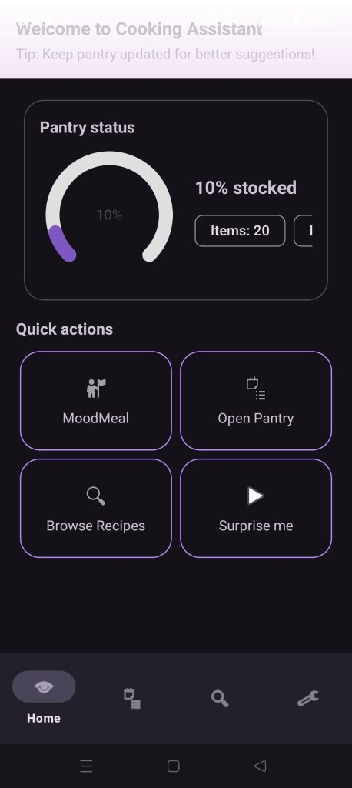
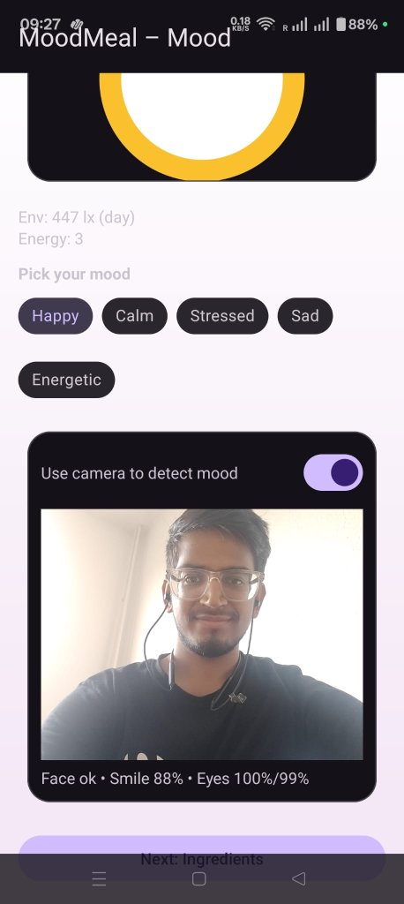
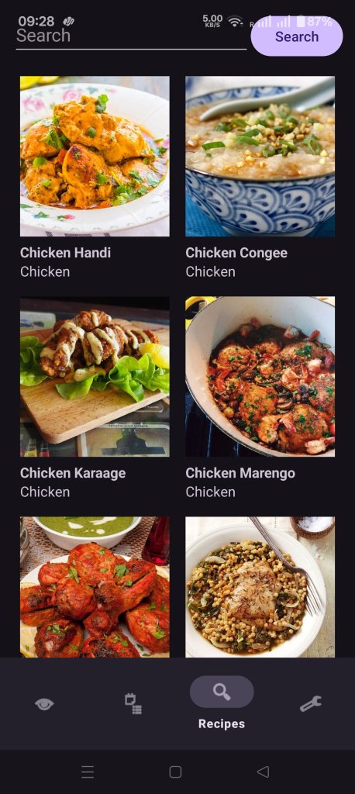
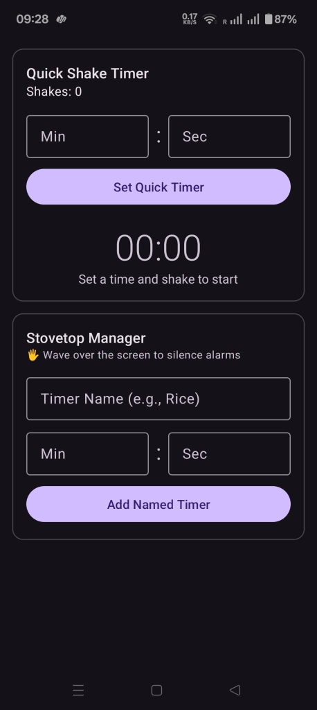
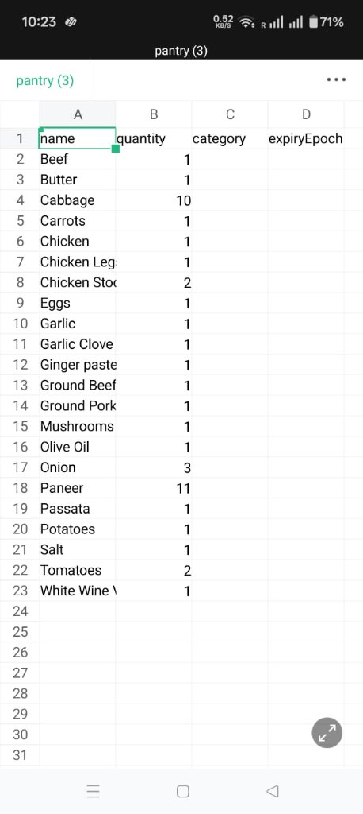

# 🍳 Cooking Assistant

A smart, hands-free Android kitchen companion that lets you follow recipes, manage timers, and track pantry inventory without getting your screen dirty.

---

## 📖 About

Cooking with messy, wet, or oily hands makes using a phone frustrating. **Cooking Assistant** solves this by turning your Android phone into an interactive kitchen tool using motion and proximity sensors, smart pantry management, and AI-powered recipe suggestions.

### 🌟 Key Highlights
- **Hands-Free Gestures**: Wave over the phone to flip recipe steps or silence alarms; shake the phone to start or pause cooking timers.
- **MoodMeal™ AI**: Uses the front camera (ML Kit) and ambient light sensor to detect your mood and suggest matching comfort meals.
- **Smart Pantry & Shopping List**: Track ingredients offline with Room SQLite, export/import via CSV, and auto-generate shopping lists for missing ingredients.
- **Recipe Discovery**: Browse and search thousands of recipes powered by TheMealDB API.
- **Flash & Sound Alerts**: Uses the camera flash as a visual strobe alert so you never miss a timer in a noisy kitchen.

---

## 📸 Screenshots

<details>
<summary><b>📱 Click to view Screenshots</b></summary>
<br>

<table align="center">
  <tr>
    <td align="center" width="50%">
      <b>Home Dashboard</b><br>
      <br>
      <i>Pantry stock gauge & quick actions</i>
    </td>
    <td align="center" width="50%">
      <b>MoodMeal™ AI</b><br>
      <br>
      <i>Face emotion & light detection</i>
    </td>
  </tr>
  <tr>
    <td align="center" width="50%">
      <b>Recipe Search</b><br>
      <br>
      <i>Search by dish or category</i>
    </td>
    <td align="center" width="50%">
      <b>Kitchen Tools & Timers</b><br>
      <br>
      <i>Shake timer & wave-to-silence alarms</i>
    </td>
  </tr>
  <tr>
    <td colspan="2" align="center">
      <b>Pantry CSV Export</b><br>
      <br>
      <i>Inventory management & CSV sync</i>
    </td>
  </tr>
</table>

</details>

---

## 📁 Project Structure

```text
Cooking_Assistant_App/
├── app/
│   ├── src/main/java/com/example/cookingassistant/
│   │   ├── adapters/          # RecyclerView list adapters
│   │   ├── api/               # TheMealDB Retrofit client & models
│   │   ├── db/                # Room SQLite database & DAOs
│   │   ├── ui/                # Activities, fragments & custom views
│   │   │   └── mood/          # MoodMeal camera & sensor detection
│   │   └── MainActivity.java  # Main navigation hub
│   ├── res/                   # Layouts, drawables & values
│   └── AndroidManifest.xml
├── screenshots/               # App preview screenshots
└── README.md
```

---

## 🛠️ Built With

- **Language & Platform**: Java 17, Android (Min SDK 24 / Target SDK 35)
- **Database**: Room SQLite Persistence
- **Networking**: Retrofit 2 + Gson
- **Image Loading**: Bumptech Glide
- **AI & Vision**: Google ML Kit Face Detection, CameraX
- **Hardware Sensors**: Accelerometer, Proximity, Ambient Light, Camera Flash (Camera2)

---

## 🚀 Getting Started

### Prerequisites
- Android Studio Ladybug or newer
- JDK 17
- Android SDK 35
- Physical Android device (recommended for sensors) or Android Emulator

### Quick Setup
1. **Clone the repository:**
   ```bash
   git clone https://github.com/Swarnim0611/Cooking_Assistant_App.git
   ```
2. **Open in Android Studio:**
   - Open Android Studio $\rightarrow$ **Open** $\rightarrow$ Select `Cooking_Assistant_App`.
   - Let Gradle sync complete.
3. **Run the App:**
   - Connect your Android phone via USB (with USB Debugging enabled).
   - Press **Run** (`Shift + F10`).
   - Grant **Camera** permission when prompted for MoodMeal and flash alerts.
